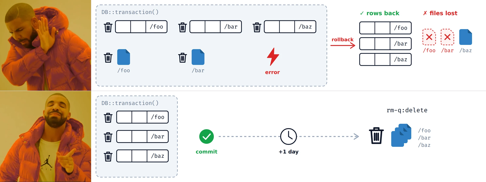
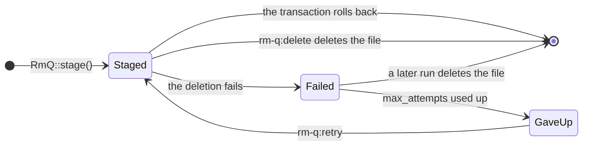

# Queue and avoid disastrous file deletions

[](https://packagist.org/packages/medilies/rm-q)
[](https://github.com/medilies/rm-q/actions?query=workflow%3Arun-tests+branch%3Amain)
[](https://github.com/medilies/rm-q/actions?query=workflow%3A"phpstan"+branch%3Amain)
<!-- [](https://packagist.org/packages/medilies/rm-q) -->



A file deletion can't be rolled back. This Laravel package stages deletions in a database table, inside your
transactions. A scheduled command deletes the files once a grace period is over, and retries the ones that fail.
When a transaction rolls back, its staging rolls back too, and the files survive.

## The problem

```php
use Illuminate\Support\Facades\DB;
use Illuminate\Support\Facades\Storage;

DB::transaction(function () use ($images) {
    /** @var \App\Models\Image $image */
    foreach ($images as $image) {
        $image->delete();
        Storage::disk('public')->delete($image->path);

        // more logic ...
    }
});
```

If an error occurs while handling the second image, the transaction rolls back the database rows of both images,
but the file of the first image is gone forever.

### Why not `DB::afterCommit()`?

`DB::afterCommit(fn () => Storage::disk('public')->delete($image->path))` fixes the rollback, but:

- **The deletion only lives in memory.** If the process dies after the commit, or the disk call fails, the file is
  never deleted.
- **The file is gone at once.** There's no time to notice a bug or restore a database backup.

### Why not a queued job?

A job on the `database` queue, on the same connection as your data, commits with your transaction, and can be
delayed and retried. It costs one job per file and a queue worker. rm-q costs one row per file and a scheduled
command, and checks every path before deleting it.

## The solution

```php
use Illuminate\Support\Facades\DB;
use Medilies\RmQ\Facades\RmQ;

DB::transaction(function () use ($images) {
    /** @var \App\Models\Image $image */
    foreach ($images as $image) {
        $image->delete();
        RmQ::stage($image->path, 'public');

        // more logic ...
    }
});
```

`RmQ::stage()` inserts a row in the `rm_q_files` table, in your transaction. A rollback removes the row with the rest
of your changes. A day later (`rm-q.after`), the scheduled `rm-q:delete` command deletes the file and its row.

## Installation

Requirements:

- PHP 8.3+ and Laravel 12 or 13.
- SQLite, MySQL, MariaDB or PostgreSQL. CI runs the test suite on SQLite, MySQL 8.4, MariaDB 11.4 and
  PostgreSQL 17. SQL Server is not tested.

```bash
composer require medilies/rm-q

php artisan vendor:publish --tag="rm-q-migrations"
php artisan migrate
```

Optionally, publish the config file:

```bash
php artisan vendor:publish --tag="rm-q-config"
```

Then schedule the command, for example in `routes/console.php`:

```php
use Illuminate\Support\Facades\Schedule;

Schedule::command('rm-q:delete')->everyFifteenMinutes()->withoutOverlapping()->onOneServer();
```

Runs must not overlap: keep `withoutOverlapping()` and `onOneServer()`.

## How it works



- `rm-q:delete` deletes the files staged longer ago than the grace period, oldest first, and removes their rows. A file
  that was already missing counts as deleted.
- A failed deletion keeps its row, with the error, and each later run retries it until it has used up
  `rm-q.max_attempts` attempts.
- An attempt counts before the file is deleted, so a file whose deletion crashes the run is given up too.

## Staging files

```php
use Medilies\RmQ\Facades\RmQ;

RmQ::stage('/var/www/storage/app/exports/report.csv'); // an absolute local path
RmQ::stage(['avatars/1.jpg', 'avatars/2.jpg'], 's3');  // paths on a disk
```

- **What it accepts:** a string, a `Stringable`, or any iterable (array, collection, generator). It returns the
  number of paths staged; duplicates are staged once.
- **Paths:** without a disk, paths must be absolute. With a disk, they are paths on that disk, and the disk must be
  configured.
- **Validation:** invalid paths throw `Medilies\RmQ\Exceptions\RmqException` before anything is staged. That covers
  empty paths, NUL bytes, stream wrappers (`phar://`, ...) and `..` segments. Inside a transaction, the exception
  aborts your change instead of leaking a file.
- **Batching:** each call is one insert (split into chunks for long lists), so stage arrays rather than looping over
  single paths.
- **Restricting local paths:** set `rm-q.allowed_directories` to the directories that local paths must be in.

### Transactions

Staging takes part in whatever transaction is open on the rm-q connection: `DB::transaction()`, nested transactions,
savepoints, deadlock retries.

> [!IMPORTANT]
> The rm-q table must be on the same connection as the data your transactions protect. Set `rm-q.connection` if
> that isn't your default connection.

### Staging the files of deleted models

```php
use Illuminate\Database\Eloquent\Model;
use Medilies\RmQ\Concerns\StagesFilesOnDelete;

class Image extends Model
{
    use StagesFilesOnDelete;

    /** Columns holding file paths, mapped to their disk. A null disk means absolute local paths. */
    public function rmqFileColumns(): array
    {
        return ['path' => 'public', 'thumbnail_path' => 's3'];
    }
}
```

Deleting an `Image` stages its files, in the same transaction as the deletion.

- **Soft deletes:** on `SoftDeletes` models, a soft delete keeps the files; `forceDelete()` stages them.
- **Raw values:** the values stored in the columns are staged; accessors and casts are ignored.
- **Partial selects:** columns left out of a `select` are read from the database before the row is deleted.
- **Invalid paths:** an invalid path makes `delete()` throw before the row is deleted.
- **Connection:** the model must be on the rm-q connection. Otherwise `delete()` throws before the row is deleted.
- **Not covered:** deletions that don't fire model events: `deleteQuietly()`, `forceDeleteQuietly()`, query
  builder deletes (`Image::where(...)->delete()`) and database cascades.

## Deleting the files

`php artisan rm-q:delete` deletes the files staged longer ago than `rm-q.after`, and retries failures. See
[Commands](#commands).

`RmQ::deleteAll($after, $limit)` does the same from your code, and returns a `Medilies\RmQ\DeletionReport`. It throws
when called inside a transaction on the rm-q connection, since that transaction's staging may still roll back.

> [!TIP]
> The grace period leaves you time to notice a bug or restore a database backup before the files are gone. To delete
> files sooner, lower `rm-q.after` and schedule the command more often.

## Monitoring

- **Stats:** `php artisan rm-q:stats` (or `--json`) shows the pending files, how many the next `rm-q:delete` run
  would process, the failures waiting for a retry, the ones that gave up, and the oldest staged file.
- **Exit code:** `rm-q:delete` exits with a failure code when a file used up its attempts. Use `->onFailure()` or
  `->emailOutputOnFailure()` on the schedule to get alerted.
- **Events:**
  - `Medilies\RmQ\Events\FileDeletionFailed` is dispatched for each failed attempt; its `willRetry` property tells
    you whether the deletion will be retried.
  - `Medilies\RmQ\Events\StagedFilesProcessed` is dispatched after each run, with its `DeletionReport`.
- **Given-up files** keep their row and error until `rm-q:retry` gives them new attempts. To give up on them for
  good, delete their rows: `Medilies\RmQ\Models\RmqFile::query()->gaveUp()->delete()`.

## Commands

| Command | Options | What it does |
| --- | --- | --- |
| `rm-q:delete` | `--after=` (seconds), `--limit=`, `--dry-run`, `--isolated` | Deletes the staged files past the grace period, oldest first, and retries failures. |
| `rm-q:stats` | `--json` | Shows the state of the rm-q table. |
| `rm-q:retry` | | Gives the failures that gave up a new round of attempts. |

## Configuration

| Key | Default | Description |
| --- | --- | --- |
| `connection` | `env('RM_Q_CONNECTION')` | Connection of the rm-q table: the one your transactions use. Null means the default connection. |
| `table` | `rm_q_files` | Name of the rm-q table. |
| `after` | `env('RM_Q_AFTER', 86400)` | Grace period, in seconds, before `rm-q:delete` deletes a staged file. |
| `chunk` | `500` | Rows read and processed per batch. |
| `max_attempts` | `3` | Attempts before a failed deletion is given up. |
| `allowed_directories` | `null` | Absolute directories that local paths must be in. Null means no restriction. |

## Things to know

- **Shared files:** only stage files that belong to the deleted record alone. A path shared with other records is
  deleted for all of them.
- **Reused paths:** if a file name doesn't change between versions (`avatars/{user_id}.jpg`), a new file uploaded
  at that path before the deletion runs will be deleted.
- **User input:** never stage paths that come from user input without validating them. `allowed_directories` adds a
  safety net for local paths.
- **Multi-tenancy:** disks are resolved when the files are deleted. With per-tenant disks, run `rm-q:delete` once
  per tenant.
- **Versioned S3 buckets:** deleting an object only adds a delete marker. Use lifecycle rules to remove old
  versions.
- **Tests:** `RmQ::deleteAll(after: 0)` deletes what the test staged, also in tests using `RefreshDatabase`. Stage
  files on a disk faked with `Storage::fake()`, or in temporary files.

## Changelog

Please see [CHANGELOG](CHANGELOG.md) for more information on what has changed recently.

## Contributing

Please see [CONTRIBUTING](CONTRIBUTING.md) for details.

## Security Vulnerabilities

Please review [our security policy](../../security/policy) on how to report security vulnerabilities.

## Credits

- [medilies](https://github.com/medilies)
- [All Contributors](../../contributors)

## License

The MIT License (MIT). Please see [License File](LICENSE.md) for more information.
