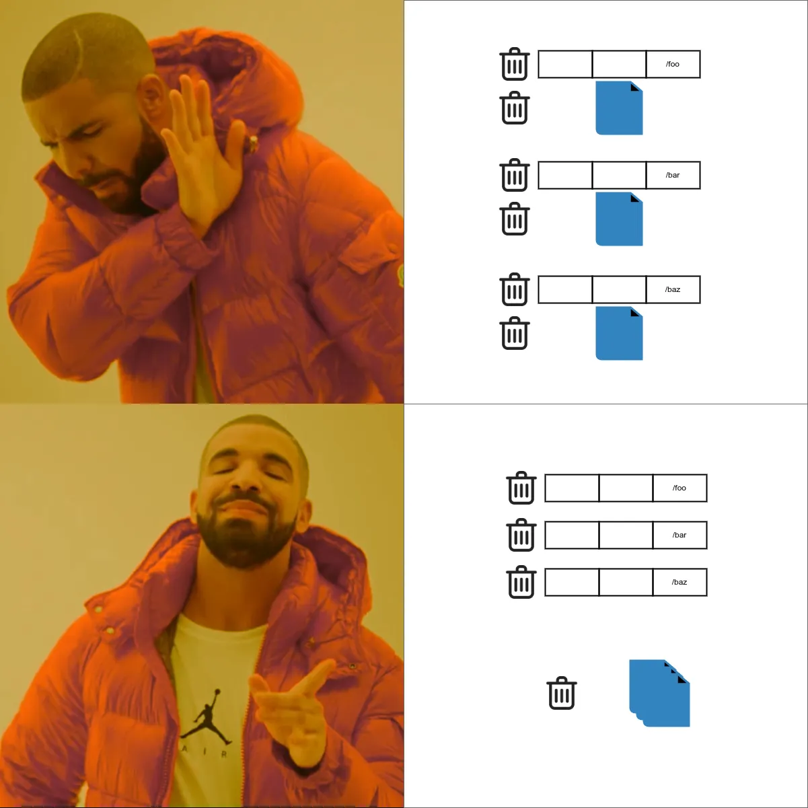

# Queue and avoid disastrous file deletions

[](https://packagist.org/packages/medilies/rm-q)
[](https://github.com/medilies/rm-q/actions?query=workflow%3Arun-tests+branch%3Amain)
[](https://github.com/medilies/rm-q/actions?query=workflow%3A"phpstan"+branch%3Amain)
<!-- [](https://packagist.org/packages/medilies/rm-q) -->

<div style="text-align: center;">
  
</div>

A file deletion can't be rolled back. This Laravel package stages deletions in a database table, inside your
transactions, and deletes the files only once that staging is committed. When a transaction rolls back, the rows and
the files both survive.

## The problem

Let's say you have a use case that resembles this:

```php
use Illuminate\Support\Facades\DB;
use Illuminate\Support\Facades\Storage;

DB::transaction(function () use ($images) {
    /** @var \App\Models\Image $image */
    foreach ($images as $image) {
        $image->delete();
        Storage::disk('public')->delete($image->path);

        // more logic ...
    }
});
```

If an error occurs while handling the second image, the transaction rolls back the database rows of both images,
but the file of the first image is gone forever.

## The solution

```php
use Illuminate\Support\Facades\DB;
use Medilies\RmQ\Facades\RmQ;

DB::transaction(function () use ($images) {
    /** @var \App\Models\Image $image */
    foreach ($images as $image) {
        $image->delete();
        RmQ::stage($image->path, 'public');

        // more logic ...
    }
});

RmQ::delete();
```

Staging inserts a row in the `rm_q_files` table, so it rolls back with the transaction. `RmQ::delete()` only deletes
the files whose staging was committed. Anything left behind, by a crashed request or a forgotten `delete()`, is
picked up later by the `rm-q:delete` command.

## Installation

Requirements: PHP 8.2+ and Laravel 12 or 13.

```bash
composer require medilies/rm-q

php artisan vendor:publish --tag="rm-q-migrations"
php artisan migrate
```

Optionally, publish the config file:

```bash
php artisan vendor:publish --tag="rm-q-config"
```

Then schedule the commands, for example in `routes/console.php`:

```php
use Illuminate\Support\Facades\Schedule;

Schedule::command('rm-q:delete')->everyFifteenMinutes()->withoutOverlapping()->onOneServer();
Schedule::command('rm-q:cleanup')->daily()->onOneServer();
```

Overlapping runs are safe; `withoutOverlapping()` and `onOneServer()` only avoid wasted work.

## How it works

1. **Stage.** `RmQ::stage()` inserts one `Staged` row per path. The insert joins the transaction that is open, if any.
2. **Commit or roll back.** A rollback removes the rows, so those files are never touched.
3. **Delete.**
   - `RmQ::delete()` and the middlewares delete the files staged by the current request or job.
   - `rm-q:delete` deletes every file staged longer ago than the grace period (`rm-q.after`, one day by default).
   - Every run claims its rows before working on them, so two runs never process the same row.
4. **Record.**
   - A row ends up `Deleted` when the file is gone. A file that was already missing counts as deleted.
   - Otherwise the row is `Failed`, with the error. Later `rm-q:delete` runs retry it, up to `rm-q.max_attempts`
     attempts.

## Staging files

```php
use Medilies\RmQ\Facades\RmQ;

RmQ::stage('/var/www/storage/app/exports/report.csv'); // an absolute local path
RmQ::stage(['avatars/1.jpg', 'avatars/2.jpg'], 's3');  // paths on a disk
```

- **What it accepts:** a string, a `Stringable`, or any iterable (array, collection, generator). It returns the
  number of paths staged; duplicates are staged once.
- **Paths:** without a disk, paths must be absolute. With a disk, they are paths on that disk, and the disk must be
  configured.
- **Validation:** invalid paths throw `Medilies\RmQ\Exceptions\RmqException` before anything is staged. That covers
  empty paths, NUL bytes, stream wrappers (`phar://`, ...) and `..` segments. Inside a transaction, the exception
  aborts your change instead of leaking a file.
- **Batching:** each call is one insert (split into chunks for long lists), so stage arrays rather than looping over
  single paths.
- **Restricting local paths:** set `rm-q.allowed_directories` to the directories that local paths must be in.

### Transactions

Staging takes part in whatever transaction is open on the rm-q connection: `DB::transaction()`, nested transactions,
savepoints, deadlock retries. `RmQ::transaction($callback, $attempts)` is a shortcut for `DB::transaction()` on that
connection.

> [!IMPORTANT]
> The rm-q table must be on the same connection as the data your transactions protect. Set `rm-q.connection` if
> that isn't your default connection.

### Staging the files of deleted models

```php
use Illuminate\Database\Eloquent\Model;
use Medilies\RmQ\Models\RmqStageOnDeleteTrait;

class Image extends Model
{
    use RmqStageOnDeleteTrait;

    /** Columns holding file paths, optionally mapped to their disk. */
    public function listFilePathColumns(): array
    {
        return ['path', 'thumbnail_path' => 's3'];
    }

    /** The disk of the columns listed without one. Null means absolute local paths. */
    public function rmqDisk(): ?string
    {
        return 'public';
    }
}
```

Deleting an `Image` stages its files, in the same transaction as the deletion.

- **Soft deletes:** on `SoftDeletes` models, a soft delete keeps the files; `forceDelete()` stages them.
- **Raw values:** the values stored in the columns are staged; accessors and casts are ignored.
- **Partial selects:** columns left out of a `select` are read from the database before the row is deleted.
- **Invalid paths:** an invalid path makes `delete()` throw before the row is deleted.
- **Not covered:** deletions that don't fire model events: `deleteQuietly()`, query builder deletes
  (`Image::where(...)->delete()`) and database cascades.

## Deleting the files

### At the end of a request

```php
Route::delete('images/{image}', DestroyImageController::class)->middleware('rm-q');
```

The `rm-q` middleware (`Medilies\RmQ\Middleware\RmqMiddleware`) deletes the files staged during the request, after
the response is sent:

- It also runs when the request failed: staging that was rolled back is gone, while committed staging is deleted.
- Errors go to your exception handler; the response is never affected.

### At the end of a queued job

```php
use Medilies\RmQ\Queue\DeleteStagedFiles;

class PurgeAlbum implements ShouldQueue
{
    public function middleware(): array
    {
        return [new DeleteStagedFiles];
    }
}
```

### Manually

`RmQ::delete()` deletes the files staged by the current request or job. Called inside a transaction, it waits for
the outermost commit, and does nothing if the transaction rolls back.

### On a schedule

`php artisan rm-q:delete` does three things:

- deletes everything staged longer ago than `rm-q.after`;
- takes back rows left behind by crashed runs;
- retries failures.

See [Commands](#commands).

> [!TIP]
> The middlewares and `RmQ::delete()` delete right away. For files you really can't afford to lose, let
> `rm-q:delete` handle them alone. The grace period leaves you time to notice a bug or restore a database backup
> before the files are gone.

## Monitoring

- **Stats:** `php artisan rm-q:stats` (or `--json`) shows the rows per status, the oldest staged file, what the next
  `rm-q:delete` run would process, and the failures that gave up.
- **Exit code:** `rm-q:delete` exits with a failure code when a file used up its attempts. Use `->onFailure()` or
  `->emailOutputOnFailure()` on the schedule to get alerted.
- **Events:**
  - `Medilies\RmQ\Events\FileDeletionFailed` is dispatched for each failed attempt; its `willRetry` property tells
    you whether the deletion will be retried.
  - `Medilies\RmQ\Events\StagedFilesProcessed` is dispatched after each run, with its `DeletionReport`.
- **Log:** a warning is logged after any run that had failures.

## Commands

| Command | Options | What it does |
| --- | --- | --- |
| `rm-q:delete` | `--after=` (seconds), `--limit=`, `--dry-run`, `--isolated` | Deletes the staged files past the grace period, takes back rows left by crashed runs, retries failures. |
| `rm-q:cleanup` | `--days=`, `--with-failed` | Removes `Deleted` rows older than `--days` (default `rm-q.cleanup_after_days`), and with `--with-failed`, the failures that gave up. |
| `rm-q:stats` | `--json` | Shows the state of the rm-q table. |
| `rm-q:retry` | | Gives the failures that gave up a new round of attempts. |

## Configuration

| Key | Default | Description |
| --- | --- | --- |
| `connection` | `env('RM_Q_CONNECTION')` | Connection of the rm-q table: the one your transactions use. Null means the default connection. |
| `table` | `rm_q_files` | Name of the rm-q table. |
| `after` | `env('RM_Q_AFTER', 86400)` | Grace period, in seconds, before `rm-q:delete` deletes a staged file. |
| `chunk` | `500` | Rows claimed and processed per batch. |
| `max_attempts` | `3` | Attempts before a failed deletion is given up. |
| `claim_timeout` | `3600` | Seconds after which the rows of a crashed run are taken back. |
| `cleanup_after_days` | `30` | How long `rm-q:cleanup` keeps processed rows, in days. |
| `allowed_directories` | `null` | Absolute directories that local paths must be in. Null means no restriction. |

## Statuses

Each row of the rm-q table (model `Medilies\RmQ\Models\RmqFile`) has a `status` (`Medilies\RmQ\Enums\Status`):

| Value | Status | Meaning |
| --- | --- | --- |
| 0 | `Staged` | Waiting to be deleted. |
| 1 | `Deleted` | The file is gone: deleted, or already missing. |
| 2 | `Failed` | The last attempt failed (see `error`). Retried while `attempts` < `max_attempts`. |
| 3 | `Processing` | Claimed by a run. Taken back after `claim_timeout` if that run died. |

## Things to know

- **Octane and queue workers:** each request and each job gets its own `RmQ` instance.
- **Shared files:** only stage files that belong to the deleted record alone. A path shared with other records is
  deleted for all of them.
- **Reused paths:** if a file name doesn't change between versions (`avatars/{user_id}.jpg`), a new file uploaded
  at that path before the deletion runs will be deleted.
- **User input:** never stage paths that come from user input without validating them. `allowed_directories` adds a
  safety net for local paths.
- **Multi-tenancy:** disks are resolved when the files are deleted. With per-tenant disks, run `rm-q:delete` once
  per tenant.
- **Versioned S3 buckets:** deleting an object only adds a delete marker. Use lifecycle rules to remove old
  versions.
- **Large batches:** files are deleted after the response is sent, but large batches still keep the worker busy.
  Leave bulk deletions to `rm-q:delete`.
- **Tests:** in tests using `RefreshDatabase`, `RmQ::delete()` runs right away. Stage files on a disk faked with
  `Storage::fake()`, or in temporary files.

## Changelog

Please see [CHANGELOG](CHANGELOG.md) for more information on what has changed recently.

## Contributing

Please see [CONTRIBUTING](CONTRIBUTING.md) for details.

## Security Vulnerabilities

Please review [our security policy](../../security/policy) on how to report security vulnerabilities.

## Credits

- [medilies](https://github.com/medilies)
- [All Contributors](../../contributors)

## License

The MIT License (MIT). Please see [License File](LICENSE.md) for more information.
